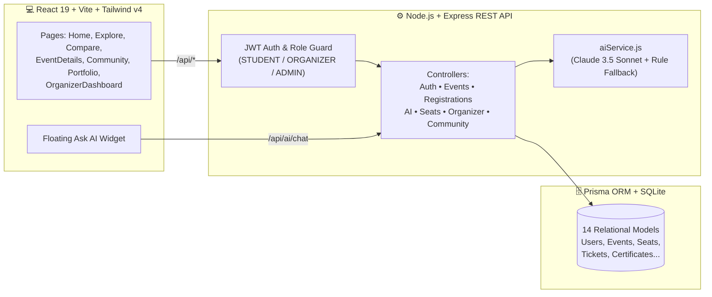

<div align="center">

# 🌐 EventSphere

### **AI-Powered Smart Campus Event Management, Venue Seat Allocation & Verified Digital Credentials Portal**

[](https://react.dev/)
[](https://tailwindcss.com/)
[](https://nodejs.org/)
[](https://www.prisma.io/)
[](https://www.anthropic.com/)
[](#)

<p align="center">
  <b>Discover Hackathons & Fests</b> • <b>AI Event Comparison</b> • <b>Interactive Seat Maps</b> • <b>Smart QR Tickets</b> • <b>Verified Student Portfolio</b>
</p>

---

</div>

## ✨ Overview

**EventSphere** transforms how university students discover, compare, and participate in campus events—and how organizers manage capacity, check-ins, and post-event credentials.

Instead of scattered Google Forms and static notice boards, EventSphere brings **AI-driven event discovery**, **atomic QR ticket generation**, **interactive auditorium seat maps**, **a campus teammate finder**, and **automated digital certificates** into a single cohesive platform.

---

## 🌟 Key Highlights & Features

| Pillar | Capabilities |
| :--- | :--- |
| 🧠 **AI Campus Intelligence** | • **Personalized Match Engine**: Scores events (`% Match`) using student branch, skills, and interests.<br>• **"Which Event Is Better?" Compare Tool**: Side-by-side comparison matrix with schedule conflict detection & AI verdict.<br>• **Ask EventSphere AI**: Floating assistant for instant answers on free events, rules, seats, and certificates.<br>• **Zero-Downtime Hybrid Architecture**: Uses Anthropic Claude API when configured and seamlessly falls back to a deterministic rule-based scoring engine when offline. |
| 🎟️ **Transactional Registration & QR Tickets** | • **ACID Seat Decrement**: Prevents overbooking via Prisma database transactions.<br>• **Solo & Squad Signups**: Built-in support for team events with min/max team size rules.<br>• **Smart QR Tickets**: Unique cryptographic ticket code generated immediately upon registration. |
| 💺 **Interactive Seat Map & Live Scanner** | • **Visual Auditorium Grid**: Real-time seat status (`Available`, `Wheelchair Accessible Row A`, `Booked`).<br>• **Smart Auto-Allocate**: One-click front-row/accessible seat assignment.<br>• **Organizer QR Check-In Scanner**: Instant ticket verification with duplicate-scan protection and audit logging. |
| 📊 **Organizer Command Center** | • **AI Demand Forecasting**: Projects final fill rates (`HIGH` / `MODERATE` / `LOW` demand) with actionable tips.<br>• **Feedback Sentiment Intelligence**: Aggregates 1–5★ attendee ratings and topic tags into sentiment summaries.<br>• **One-Click Certificate Issuance**: Bulk-issue verified participation & winner certificates to attendees. |
| 🤝 **Community Hub & Student Portfolio** | • **Teammate Finder**: Filterable discussion feed with skill tags (`#React`, `#Python`, `#UI/UX`) and nested replies.<br>• **Verified Student Portfolio**: Showcases events attended, merit certificates earned, and editable AI skill tags. |

---

## 🏗️ System Architecture



---

## 📂 Project Structure

```text
eventsphere/
├── client/                         # React 19 + Vite + Tailwind CSS v4 Frontend
│   ├── src/
│   │   ├── components/
│   │   │   ├── Navbar.jsx          # Role-aware top navigation
│   │   │   └── AIChatWidget.jsx    # Floating "Ask EventSphere AI" assistant
│   │   ├── context/
│   │   │   └── AuthContext.jsx     # JWT session & user state provider
│   │   ├── pages/
│   │   │   ├── Home.jsx            # Hero banner, AI recommendations & categories
│   │   │   ├── EventList.jsx       # Search, multi-filter & sort event catalog
│   │   │   ├── EventDetails.jsx    # Event info, team signup, Seat Map, reviews
│   │   │   ├── CompareEvents.jsx   # Side-by-side AI event comparison engine
│   │   │   ├── MyRegistrations.jsx # Smart QR ticket stubs & seat badges
│   │   │   ├── Community.jsx       # Teammate finder & organizer announcements
│   │   │   ├── Portfolio.jsx       # Verified certificates & editable skill profile
│   │   │   ├── OrganizerDashboard.jsx # KPIs, QR scanner, AI demand & cert issuer
│   │   │   ├── Login.jsx           # Login with quick demo credentials
│   │   │   └── Register.jsx        # Student & Organizer onboarding
│   │   └── App.jsx                 # Application router
│   └── vite.config.js              # Dev server with /api proxy -> localhost:5000
│
├── server/                         # Node.js + Express Backend
│   ├── prisma/
│   │   ├── schema.prisma           # 14-model relational schema
│   │   └── seed.js                 # Seeds 9 categories, 10 users, 28 events, tickets
│   ├── src/
│   │   ├── controllers/            # 7 modular route controllers
│   │   ├── middleware/auth.js      # JWT verification & role authorization
│   │   ├── routes/                 # Express routers (/auth, /events, /ai, /seats, etc.)
│   │   ├── services/aiService.js   # Claude API client + rule-based fallback
│   │   └── index.js                # Express app entry point
│   └── tests/
│       └── api.test.js             # End-to-end automated integration test suite
└── PROGRESS.md                     # Detailed build log across Phases 1–6
```

---

## 🚀 Quick Start Guide

### Prerequisites
- **Node.js** `v18+` (tested on `v24`)
- **npm** `v9+`

### 1️⃣ Clone & Setup Backend (`server/`)

```bash
git clone https://github.com/sagamdeep826-pixel/eventsphere.git
cd eventsphere/server

# Install dependencies
npm install

# Configure environment variables
cp .env.example .env

# Run Prisma migrations & seed 28+ sample events
npx prisma migrate dev --name init
npm run seed

# Run the automated API test suite (8/8 checks)
npm test

# Start the backend server on http://localhost:5000
npm run dev
```

#### Backend `.env` Configuration:
```env
PORT=5000
DATABASE_URL="file:./dev.db"
JWT_SECRET="eventsphere_super_secret_jwt_key_2026"
ANTHROPIC_API_KEY=""   # Optional: Leave blank to use built-in smart rule-based AI fallback
```

### 2️⃣ Setup & Run Frontend (`client/`)

Open a new terminal window:

```bash
cd eventsphere/client

# Install dependencies
npm install

# Start Vite dev server on http://localhost:5173
npm run dev
```

Visit **`http://localhost:5173`** in your browser!

---

## 🔐 Demo Accounts (Pre-Seeded)

All demo accounts share the password: **`password123`**

| Role | Email | Name | Highlights to Test |
| :--- | :--- | :--- | :--- |
| 🛡️ **Admin** | `admin@eventsphere.edu` | Dr. Sarah Administrator | Full access to all 28 campus events in **Organizer Hub** |
| 🎯 **Organizer** | `organizer.tech@eventsphere.edu` | Prof. Alan Turing Club | Manage HackHorizon & AI Masterclass, scan QR tickets, issue certificates |
| 🎭 **Organizer** | `organizer.cultural@eventsphere.edu` | Cultural Council Head | Manage Cultural Fest & Dance Night |
| 🏆 **Organizer** | `organizer.sports@eventsphere.edu` | Sports Directorate | Manage Valorant Esports & Cricket League |
| 🎓 **Student** | `student1@eventsphere.edu` | Alex Chen | CS Year 3 • Has QR tickets, community post & Winner Certificate in **Portfolio** |
| 🎓 **Student** | `student2@eventsphere.edu` | Priya Sharma | IT Year 4 • UI/UX & Web Dev profile |
| 🎓 **Student** | `student3@eventsphere.edu` | Marcus Johnson | Electronics Year 2 • Robotics & Gaming profile |

---

## 🔌 REST API Endpoints Summary

<details>
<summary><b>Click to expand full API endpoint table (24 endpoints)</b></summary>

| Category | Method | Endpoint | Access | Description |
| :--- | :---: | :--- | :---: | :--- |
| **Health** | `GET` | `/api/health` | Public | Server health status check |
| **Auth** | `POST` | `/api/auth/register` | Public | Register Student or Organizer account |
| **Auth** | `POST` | `/api/auth/login` | Public | Authenticate & return JWT |
| **Auth** | `GET` | `/api/auth/me` | Auth | Get current user & student profile |
| **Events** | `GET` | `/api/events` | Public | Search, filter (`category`, `price`, `online`) & sort events |
| **Events** | `GET` | `/api/events/categories` | Public | List all 9 campus event categories |
| **Events** | `GET` | `/api/events/slug/:slug` | Public | Get full event details, layout & community posts |
| **Events** | `GET` | `/api/events/:id` | Public | Get event by ID |
| **Events** | `GET` | `/api/events/:id/similar` | Public | Get similar events in the same category |
| **Registration** | `POST` | `/api/registrations` | Auth | Atomic event registration + QR ticket generation |
| **Registration** | `GET` | `/api/registrations/my-registrations` | Auth | Get user's registrations, QR codes & seats |
| **AI Engine** | `GET` | `/api/ai/recommendations` | Public/Auth | Personalized event match scores & explanations |
| **AI Engine** | `POST` | `/api/ai/compare` | Public/Auth | Compare two events side-by-side with conflict check |
| **AI Engine** | `POST` | `/api/ai/chat` | Public/Auth | Conversational campus event assistant |
| **Seats & Scan** | `GET` | `/api/seats/event/:eventId` | Public | Get or auto-initialize auditorium seat map |
| **Seats & Scan** | `POST` | `/api/seats/allocate` | Auth | Book a specific seat or Smart Auto-Allocate |
| **Seats & Scan** | `POST` | `/api/attendance/verify` | Organizer | Verify QR ticket code & log attendance |
| **Seats & Scan** | `GET` | `/api/attendance/logs/:eventId` | Organizer | List scan history for an event |
| **Organizer** | `GET` | `/api/organizer/dashboard` | Organizer | KPIs, AI demand forecast & feedback intelligence |
| **Organizer** | `POST` | `/api/organizer/events` | Organizer | Create and publish a new event |
| **Organizer** | `PATCH` | `/api/organizer/events/:id/status` | Organizer | Update event status |
| **Organizer** | `POST` | `/api/organizer/events/:id/certificates` | Organizer | Bulk or individual merit certificate issuance |
| **Community** | `GET` | `/api/community/posts` | Public | List discussion & teammate finder posts |
| **Community** | `POST` | `/api/community/posts` | Auth | Create discussion post or organizer announcement |
| **Community** | `POST` | `/api/community/posts/:postId/comments` | Auth | Reply to a community post |
| **Community** | `GET` | `/api/community/feedback/:eventId` | Public | Get ratings and reviews for an event |
| **Community** | `POST` | `/api/community/feedback` | Auth | Submit 1–5★ event rating & tags |
| **Portfolio** | `GET` | `/api/community/portfolio` | Auth | Get student stats, history & verified certificates |
| **Portfolio** | `PUT` | `/api/community/profile` | Auth | Update student skills, branch & interests |

</details>

---

## 🗄️ Database Models (Prisma)

EventSphere uses **14 interconnected models** in `server/prisma/schema.prisma`:
`User` • `StudentProfile` • `Category` • `Event` • `VenueLayout` • `Seat` • `Registration` • `Ticket` • `AttendanceLog` • `CommunityPost` • `Comment` • `Feedback` • `Certificate` • `Notification`

> 💡 **PostgreSQL Ready**: The schema uses portable types and standard relations—switching from SQLite to PostgreSQL for cloud deployment requires only changing `provider = "postgresql"` in `schema.prisma`.

---

<div align="center">
  <b>Built with ❤️ for Campus Communities, Hackathons & Student Innovators</b>
</div>
